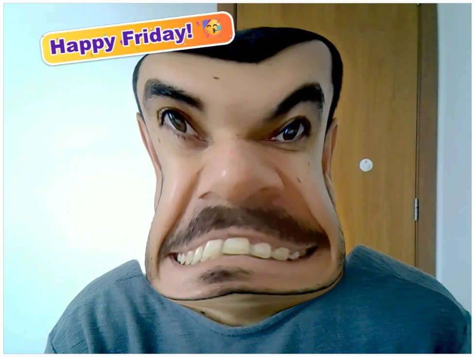
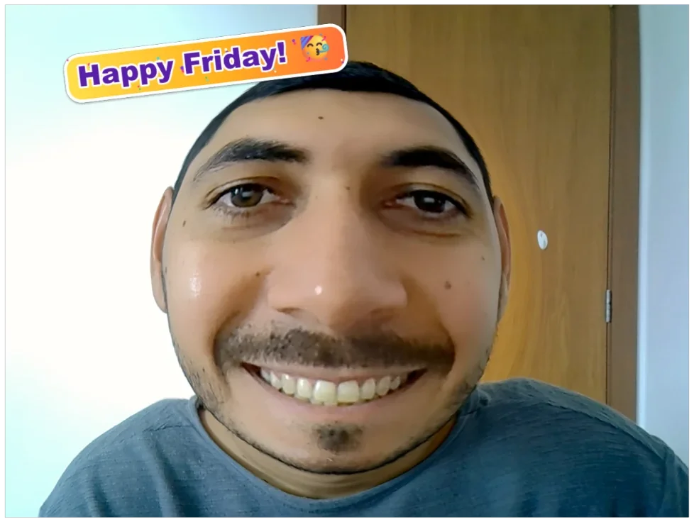
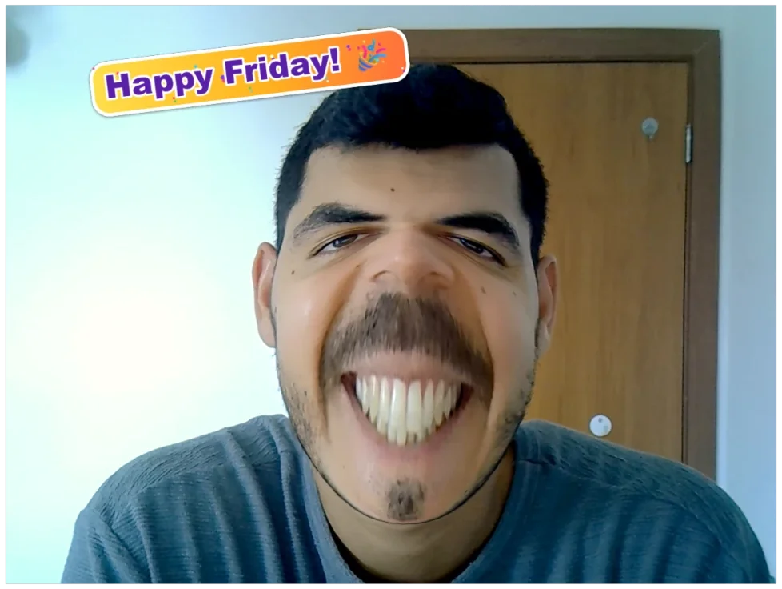
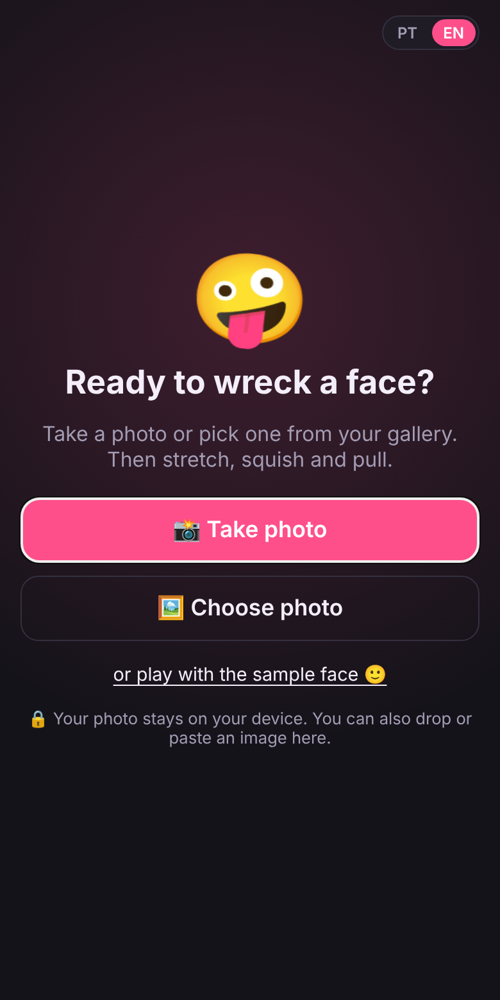
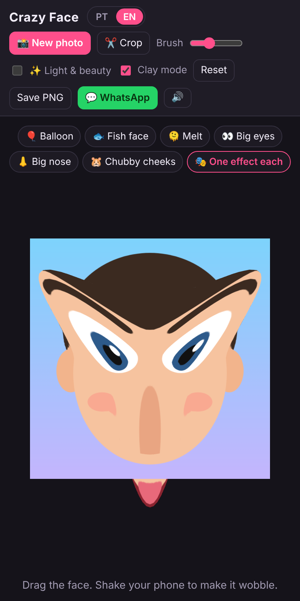

# Crazy Face 🤪

Take a selfie or pick a photo, then squish, stretch and pull the faces around until nobody recognizes anyone. Made for laughing with friends and sending the result straight to the group chat.

**Play now: https://devsuperman.github.io/crazy-face/**

  
  
  

  
  

- Works in the browser, on phones and computers. Nothing to install.
- **Your photos never leave your device.** There are no uploads and no servers: everything, face detection included, runs on your phone or computer.
- In Brazilian Portuguese or English: it follows your browser's language, and the **PT | EN** switch (top of the screen) changes it any time. Below, buttons are named in English, with the Portuguese label in parentheses.

## How to play

1. **Get a photo.** On the start screen, tap **📸 Take photo** (Tirar foto) to use the camera or **🖼️ Choose photo** (Escolher foto) to pick one from your gallery. You can also drop or paste an image, or just play with the cartoon face.
2. **Stretch it.** Drag any part of the face to pull it. Use several fingers at once on a phone.
3. **Go crazy.** Tap the effect buttons, shake your phone, and make some noise.
4. **Share it.** Tap **📤 Share with friends** (Compartilhar com amigos) and pick one of three clear choices: **💾 Save to gallery**, **💬 Send to WhatsApp** or **🔗 Share the Crazy Face link**.

Tap **📸 New photo** (Nova foto) any time to start over with another photo (and **↩ Back to the previous photo** (Voltar para a foto de antes) if you change your mind).

## Features

- **Made for phones.** The photo gets the screen; everything you tap sits at the bottom, in thumb reach: a row of effects you can swipe sideways, and **📸 New photo**, **⚙️ Settings** (Ajustes) and **📤 Share with friends**. **↺ Reset** sits on the top-right corner of the photo, always one tap away. Settings holds the less used controls: crop, light & beauty, clay mode, the Friday sticker and brush size.

### 📸 Camera

- Full-screen camera with a 3-2-1 countdown, beeps, a flash and a shutter sound.
- **🔄** switches between the front and back cameras.
- **💡 Light:** on the front camera the screen glows around the preview to light up your face (it turns on by itself in a dark room); on the back camera it turns on the flashlight, if the phone has one.
- **Looking good?** (Ficou boa?) Check the photo before using it: **✔ Use this one** (Usar esta) or **🔁 Retake** (Tirar outra).

### ✨ Light & beauty (Luz e beleza)

Dark or dull photos get a light fix, a strong skin smoothing and a warm glow on the face, like a ring light, with the eyes and mouth kept sharp. It's on for camera photos and for dark gallery photos, and you can turn it off at any time in **⚙️ Settings**.

### ✂️ Crop (Recortar)

Crop and rotate the photo before playing: free, 1:1, 3:4, 4:3 or 9:16, plus quarter turns.

### 🤹 Effects

| Button | In Portuguese | What it does |
|---|---|---|
| 🎈 Balloon | Balão | Inflates the face like a balloon |
| 🐟 Fish face | Cara de peixe | Puckers the face into a fish face |
| 🫠 Melt | Derreter | Melts the face down |
| 👀 Big eyes | Olhão | Giant eyes |
| 👃 Big nose | Narigão | Giant nose |
| 🐹 Chubby cheeks | Bochechas | Hamster cheeks |
| 🎭 One effect each | Um efeito pra cada | Every face gets a different effect |

### 👨‍👩‍👧‍👦 Group photos

Faces are found automatically, even small ones in group shots. Every effect hits **every face** in the photo at once (up to 6). There's nothing to mark by hand.

### 🧱 Clay mode (Modo massinha)

On by default: the face keeps the shape you give it. **Reset** (Resetar) puts it back. Turn clay mode off and the face wobbles back on its own like jelly.

### 🎉 Friday (Sextou)

On Fridays only, a party sticker shows up at the top of the photo (beside the face, not over it) ("Happy Friday!" in English, "SEXTOU!" in Portuguese). Drag it, pinch to resize and rotate it, or tap it for a little party. It goes into the saved picture too.

### 🔊 Sounds and jokes

- Cartoon sounds: a rubbery creak while you stretch and a *boing* when you let go. Tap 🔊 to mute.
- Pull too far and the face complains with an **"OUCH!"** (**"AI!"** in Portuguese).
- **Shake your phone** to make the face jiggle (on iPhone, allow motion access on the first tap).

### 📤 Sharing

**📤 Share with friends** (Compartilhar com amigos) opens a small menu with three choices. Each one says under its name exactly what it sends, and a line at the bottom of the screen tells you what happened.

- **💾 Save to gallery** (Salvar na galeria) keeps the picture: a sharp JPEG at your photo's full resolution, cropped to the stretched face, on white. On Android and computers it's downloaded (it shows in the gallery or the Downloads folder). On iPhone the share menu opens, and **Save Image** puts it in Photos.
- **💬 Send to WhatsApp** (Enviar no WhatsApp) sends the picture with a joke that invites your friends to make their own, plus the link to the site. On phones the share menu opens: pick WhatsApp (or any other app). On computers the picture is copied and WhatsApp opens with the text, so you pick a chat and paste (Ctrl+V). If the browser can't copy images, the picture is downloaded so you can attach it.
- **🔗 Share the Crazy Face link** (Compartilhar o link do Crazy Face) sends only the link, with an invite and no photo, so friends can come and make their own. On phones the share menu opens; on computers the link is copied.

## Tips

- The camera needs a secure page (`https://`), which the live site already is. If the browser asks, allow camera access.
- If your browser has no camera support, **📸 Take photo** (Tirar foto) opens your phone's own camera app instead.

## For developers

See [docs/DEVELOPMENT.md](docs/DEVELOPMENT.md) for the tech stack, how the features work, and how to run and build the project.
